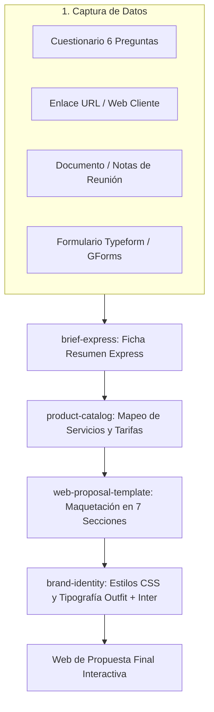

# Walkthrough: Sistema Integral de Generación de Propuestas Web

Este documento resume la creación de la skill **`brief-express`**, la arquitectura del ecosistema de 4 skills en Antigravity y la guía paso a paso para generar propuestas comerciales de alta conversión para clientes.

---

## 1. Arquitectura de las 4 Skills

El sistema de propuestas comerciales se compone de 4 skills interconectadas ubicadas en la carpeta `.agents/skills/`:

| # | Skill | Archivo Fuente | Función Clave |
|---|---|---|---|
| **1** | **`brand-identity`** | [`SKILL.md`](file:///c:/Users/elisa/Documents/Antigravity/.agents/skills/brand-identity/SKILL.md) | Define colores corporativos (`#0F172A`, `#3B82F6`), tipografías (`Outfit`, `Inter`) y el tono de voz de la marca. |
| **2** | **`product-catalog`** | [`SKILL.md`](file:///c:/Users/elisa/Documents/Antigravity/.agents/skills/product-catalog/SKILL.md) | Catálogo oficial de servicios técnicos y precios fijos (UI/UX $1,500, Frontend $2,500, Retainer $300/mes). |
| **3** | **`web-proposal-template`** | [`SKILL.md`](file:///c:/Users/elisa/Documents/Antigravity/.agents/skills/web-proposal-template/SKILL.md) | Esqueleto obligatorio en 7 secciones de ventas y snippets CSS (glassmorphism, animaciones, tarjetas). |
| **4** | **`brief-express`** | [`SKILL.md`](file:///c:/Users/elisa/Documents/Antigravity/.agents/skills/brief-express/SKILL.md) | Captura inteligente de datos del prospecto (cuestionario, URL, doc o formulario) y validación previa. |

---

## 2. Flujo de Trabajo (Pipeline de Venta)



---

## 3. Detalle de la Skill Creada: `brief-express`

La nueva skill [`brief-express`](file:///c:/Users/elisa/Documents/Antigravity/.agents/skills/brief-express/SKILL.md) resuelve la brecha entre la estética de una propuesta y su relevancia comercial:

### Modos de Operación
1. **Modo A (Cuestionario Interactivo):** Si el usuario no proporciona información, el asistente formula 6 preguntas esenciales (Cliente, Dolor, Objetivo, Servicios, Plazos/Presupuesto, Referentes).
2. **Modo B (Extracción por URL):** Inspecciona sitios web o perfiles de LinkedIn extrayendo dolores evidentes y propuesta de valor sin preguntar lo obvio.
3. **Modo C (Documentos/Notas):** Escanea transcripciones de llamadas o notas de briefing.
4. **Modo D (Formularios):** Mapea campos de encuestas directamente a las secciones de la propuesta.
5. **Ficha Resumen Express:** Genera una validación compacta de 4 líneas antes de redactar el documento final.

---

## 4. Prueba Práctica Simulada: Aura Studio

Para validar el ecosistema completo, se generó una propuesta real interactiva para el cliente ficticio **Aura Studio** (estudio boutique de arquitectura e interiorismo).

### Datos de la Simulación:
* **Problema:** Su web actual era lenta y no reflejaba el ticket alto (+50.000€) de sus obras físicas.
* **Solución:** Plataforma web en Next.js con diseño curatorial, carga instantánea y optimización de galerías.
* **Servicios cotizados según catálogo:**
  * `Servicio de Diseño UI/UX Custom`: **$1,500 USD**
  * `Desarrollo Frontend React/Next.js`: **$2,500 USD**
  * `Retainer de Soporte y Mantenimiento`: **$300 USD / mes**
  * **Inversión inicial:** **$4,000 USD**

### Entregable Web Generado:
* **Archivo:** [`index.html`](file:///c:/Users/elisa/Documents/Antigravity/propuesta-aura-studio/index.html)
* **Ubicación:** `c:\Users\elisa\Documents\Antigravity\propuesta-aura-studio\index.html`
* **Características:**
  * Maquetación en las 7 secciones obligatorias.
  * Tipografías Google Fonts `Outfit` e `Inter`.
  * Efectos visuales de `glassmorphism` y tarjetas corporativas.
  * Tabla de desglose de inversión con cálculo de totales.
  * Modal interactivo de aceptación de propuesta (`#btn-accept-proposal`).

---

## 5. Guía Rápida de Uso en el Día a Día

Para generar una propuesta en cualquier momento, puedes usar los siguientes prompts:

```markdown
# Opción 1: Con cuestionario interactivo
"Quiero crear una propuesta para un nuevo cliente. Hazme las preguntas del brief."

# Opción 2: A partir de una web o LinkedIn
"Crea una propuesta analizando la web de este cliente: https://ejemplo.com"

# Opción 3: A partir de notas de una reunión
"Aquí tienes mis notas de la llamada con el cliente: [pegar texto]. Prepárame la propuesta web."
```
